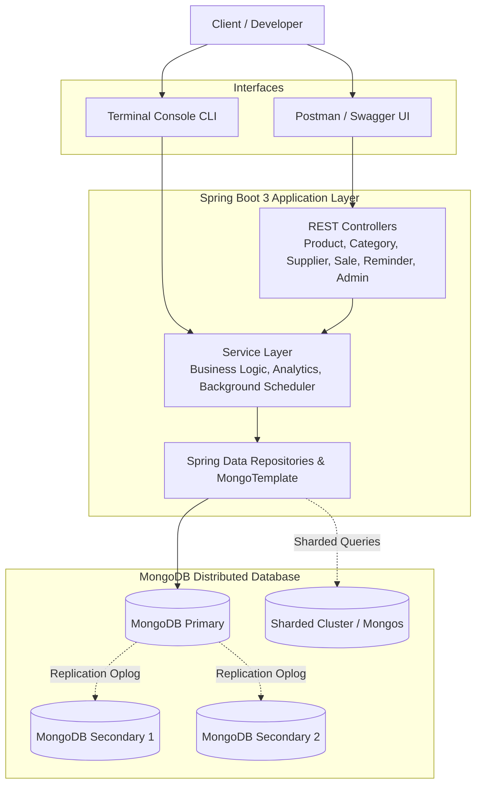

# 📦 SmartStock Pro

<p align="center">
  <strong>Enterprise-Grade Distributed Inventory & Expiry Management System</strong><br>
  <em>Powered by Spring Boot 3.5 & MongoDB 8.0</em>
</p>

<p align="center">
  
  
  
  
  
</p>

---

## 📑 Table of Contents
- [Project Overview](#-project-overview)
- [Key Features](#-key-features)
- [System Architecture](#-system-architecture)
- [MongoDB Data Modeling & Relationships](#-mongodb-data-modeling--relationships)
- [Technology Stack](#-technology-stack)
- [Getting Started](#-getting-started)
- [Interactive Console CLI](#-interactive-console-cli)
- [REST API Reference & Swagger](#-rest-api-reference--swagger)
- [Advanced MongoDB Features](#-advanced-mongodb-features)
  - [MongoDB Aggregation Pipelines](#1-mongodb-aggregation-pipelines)
  - [Replica Set Architecture (High Availability)](#2-replica-set-architecture-high-availability)
  - [Sharding Architecture (Horizontal Scaling)](#3-sharding-architecture-horizontal-scaling)
- [Automated Scheduled Tasks](#-automated-scheduled-tasks)
- [Visual Showcase & Output Evidence](#-visual-showcase--output-evidence)
- [Project Structure](#-project-structure)

---

## 🌟 Project Overview

**SmartStock Pro** is an end-to-end inventory tracking and expiry monitoring solution engineered to handle perishable inventory, complex document relationships, real-time stock alert thresholds, automated background scheduling, and distributed database scaling.

Built on **Spring Boot 3** and **MongoDB 8**, the system offers dual-interface interaction:
1. **RESTful Web Services** with comprehensive OpenAPI / Swagger documentation and Postman test collections.
2. **Interactive Terminal CLI** featuring ASCII-formatted tabular dashboards for terminal environments.

---

## ✨ Key Features

- **Product & Inventory Lifecycle**: Complete CRUD lifecycle with dynamic price, quantity, threshold limits, warehouse shelf location, and batch tracking.
- **Automated Expiry & Low-Stock Alerts**: Background scheduled daemon (`@Scheduled`) scanning inventory to flag products nearing expiration dates or falling below minimum thresholds.
- **Advanced Aggregation Pipelines**: Built-in multi-stage analytics pipelines (`$match`, `$group`, `$sort`, `$lookup`, `$project`) generating business intelligence reports.
- **Distributed Architecture Ready**: Complete support for MongoDB **3-Node Replica Sets** (zero-downtime failover) and **Horizontal Sharding** (keyed by `categoryId`).
- **Automated Database Seeder**: Pre-configured bootstrap runner that populates categories, suppliers, inventory details, historical sales, and sample alerts upon initial startup.
- **Built-in Interactive CLI**: Rich console user interface with formatted table outputs for headless execution.

---

## 🏛 System Architecture



---

## 🧩 MongoDB Data Modeling & Relationships

MongoDB documents are designed with referenced data modeling, mimicking enterprise document normalization patterns:

| Relationship Type | Entities Involved | Primary Key (`_id`) | Foreign Key Reference | Description |
|:---|:---|:---|:---|:---|
| **One-to-One** | `Product` ↔ `InventoryDetails` | `Product._id` | `InventoryDetails.productId` | Warehouse location, batch number, and last audit date |
| **One-to-Many** | `Category` → `Product` | `Category._id` | `Product.categoryId` | Grouping products under standard category hierarchies |
| **Many-to-One** | `Product` → `Supplier` | `Supplier._id` | `Product.supplierId` | Vendor information and emergency supplier contacts |
| **One-to-Many** | `Product` → `Sale` | `Product._id` | `Sale.productId` | Tracking product order history and monthly sales trends |

### Sample Document Schemas

```json
// Product Document
{
  "_id": "6a313e17690c60685b5c5ca3",
  "name": "Amul Gold Milk 1L",
  "price": 66.0,
  "quantity": 8,
  "categoryId": "6a313e17690c60685b5c5c9c",
  "supplierId": "6a313e17690c60685b5c5ca0",
  "expiryDate": "2026-06-20",
  "thresholdQuantity": 15
}
```

```json
// InventoryDetails Document (1-to-1)
{
  "_id": "6a313e17690c60685b5c5caa",
  "productId": "6a313e17690c60685b5c5ca3",
  "warehouseLocation": "Cold Storage A1",
  "batchNumber": "MILK-001",
  "lastAuditedDate": "2026-06-18"
}
```

---

## 💻 Technology Stack

| Layer | Component | Version | Purpose |
|:---|:---|:---|:---|
| **Runtime** | Java Development Kit (JDK) | 21 (LTS) | Virtual threads & modern Java runtime |
| **Framework** | Spring Boot | 3.5.x | Core application framework & dependency injection |
| **Database** | MongoDB Community Server | 8.x | Distributed document database |
| **Persistence** | Spring Data MongoDB | 4.x | Repository abstractions and `MongoTemplate` queries |
| **API Docs** | SpringDoc OpenAPI | 2.8.x | Automated Swagger UI & OpenAPI 3 specification |
| **Build Tool** | Apache Maven | 3.9+ | Dependency resolution and build lifecycle |
| **Testing** | Postman & JUnit 5 | Latest | Automated and manual REST endpoint verification |

---

## 🚀 Getting Started

### 1. Prerequisites
- **Java 21** or later installed (`java -version`)
- **Maven 3.9+** installed (`mvn -v`)
- **MongoDB 8.x** running locally or accessible via network URI

### 2. Verify MongoDB Service
Ensure MongoDB daemon is running:
```cmd
# Windows Service
net start MongoDB

# Open MongoDB Shell to verify connection
mongosh
```

### 3. Clone & Configure
Open `app/src/main/resources/application.yaml` to configure your connection string if different from default localhost:
```yaml
spring:
  application:
    name: SmartStockPro
  data:
    mongodb:
      uri: "mongodb://127.0.0.1:27017/smartstock_pro"

server:
  port: 8080
```

### 4. Build and Run
Execute commands from within the `app` directory:

```bash
cd app

# Build project and run tests
mvn clean install

# Launch Spring Boot Application
mvn spring-boot:run
```

> [!NOTE]
> On first startup, `DatabaseSeeder` will automatically detect an empty database and seed categories, suppliers, products, inventory records, and sales history.

---

## 🖥 Interactive Console CLI

SmartStock Pro features an interactive terminal CLI with formatted table printing for administrative terminal usage.

To launch in interactive terminal mode:
```bash
cd app
mvn compile exec:java -Dexec.mainClass="com.SmartStockPro.app.AppApplication"
```

```
===========================================
*    SMARTSTOCK PRO INVENTORY SYSTEM CLI  *
===========================================
1. Product Management
2. Category Management
3. Supplier Management
4. Sales Management
5. View Analytics Reports
6. View System Reminders
7. Exit
===========================================
Select option (1-7):
```

---

## 📡 REST API Reference & Swagger

Interactive Swagger UI is accessible at:
🔗 **`http://localhost:8080/swagger-ui/index.html`**

### API Endpoints Summary

#### 📦 Products (`/api/products`)
| Method | Endpoint | Description |
|:---|:---|:---|
| `POST` | `/api/products` | Create a new product with category and supplier links |
| `GET` | `/api/products` | Retrieve all products |
| `GET` | `/api/products/{id}` | Get product details by ID |
| `PUT` | `/api/products/{id}` | Update product attributes |
| `DELETE` | `/api/products/{id}` | Remove product from inventory |
| `GET` | `/api/products/search/{name}` | Case-insensitive product search by name |
| `GET` | `/api/products/availability/{name}` | Check real-time stock availability status |

#### 🏷️ Categories (`/api/categories`)
| Method | Endpoint | Description |
|:---|:---|:---|
| `POST` | `/api/categories` | Add a new category |
| `GET` | `/api/categories` | List all categories |
| `GET` | `/api/categories/{id}` | Retrieve category by ID |
| `PUT` | `/api/categories/{id}` | Update category name |
| `DELETE` | `/api/categories/{id}` | Delete category |

#### 🚚 Suppliers (`/api/suppliers`)
| Method | Endpoint | Description |
|:---|:---|:---|
| `POST` | `/api/suppliers` | Register supplier with contact phone |
| `GET` | `/api/suppliers` | List all registered suppliers |
| `GET` | `/api/suppliers/{id}` | Retrieve supplier profile |
| `PUT` | `/api/suppliers/{id}` | Update supplier details |
| `DELETE` | `/api/suppliers/{id}` | Delete supplier |

#### 💰 Sales (`/api/sales`)
| Method | Endpoint | Description |
|:---|:---|:---|
| `POST` | `/api/sales` | Record a new sale (auto-decrements product quantity) |
| `GET` | `/api/sales` | List all completed transactions |
| `GET` | `/api/sales/report` | Retrieve monthly aggregated sales report |

#### 🔔 Reminders & Notifications (`/api/reminders`)
| Method | Endpoint | Description |
|:---|:---|:---|
| `POST` | `/api/reminders` | Create custom reminder notification |
| `GET` | `/api/reminders` | Retrieve system alert history |

#### 📊 Analytics & Reporting (`/api/analytics`)
| Method | Endpoint | Description |
|:---|:---|:---|
| `GET` | `/api/analytics/category-inventory` | Category-wise stock totals and distribution |
| `GET` | `/api/analytics/monthly-sales` | Monthly sales figures and transaction volume |
| `GET` | `/api/analytics/top-selling` | Top selling products ranking |
| `GET` | `/api/analytics/low-stock` | Products below safety stock threshold |
| `GET` | `/api/analytics/expiring` | Products expiring within threshold window |

#### ⚙️ Cluster Administration (`/api/admin`)
| Method | Endpoint | Description |
|:---|:---|:---|
| `GET` | `/api/admin/replication` | Returns Replica Set status or architecture summary |
| `GET` | `/api/admin/sharding` | Returns Sharded Cluster status or sharding concepts |

---

## ⚡ Advanced MongoDB Features

### 1. MongoDB Aggregation Pipelines

SmartStock Pro leverages native MongoDB aggregation pipelines via `MongoTemplate` to deliver high-performance analytics without client-side calculation:

- **Category-wise Inventory Count**:
  `$group` by `categoryId`, `$sum` total products, and `$project` into human-readable report documents.
- **Top-Selling Products**:
  `$group` by `productId`, summing `quantitySold`, sorted descending with `$limit`.
- **Expiring Products Alert**:
  `$match` filtering documents where `expiryDate <= now() + thresholdDays`.

### 2. Replica Set Architecture (High Availability)

To ensure fault tolerance and zero data loss, SmartStock Pro supports a 3-node MongoDB Replica Set:
- **Primary Node**: Handles all read/write operations and appends to the `oplog`.
- **Secondary Nodes (x2)**: Asynchronously replicate operations from the primary.
- **Automatic Failover**: If the primary node crashes, remaining members elect a new primary within seconds.

```javascript
// Initialization in mongosh
rs.initiate({
  _id: "rs0",
  members: [
    { _id: 0, host: "localhost:27018" },
    { _id: 1, host: "localhost:27019" },
    { _id: 2, host: "localhost:27020" }
  ]
});
rs.status();
```

### 3. Sharding Architecture (Horizontal Scaling)

SmartStock Pro supports horizontal scaling using MongoDB Sharded Clusters:
- **Shard Key**: `{ "categoryId": 1 }` – groups products by category across shards for optimal range query routing.
- **Components**: `mongos` query router, Config Server replica set, and independent shard replica sets.

```javascript
// Enabling Sharding on SmartStock Pro database
sh.enableSharding("smartstock_pro");
sh.shardCollection("smartstock_pro.products", { "categoryId": 1 });
sh.status();
```

---

## ⏰ Automated Scheduled Tasks

The application runs background monitoring using Spring's task scheduling engine (`SchedulerService`):

- **Production Schedule**: Runs daily at 08:00 AM (`@Scheduled(cron = "0 0 8 * * ?")`).
- **Live Demo Schedule**: Runs every 60 seconds (`@Scheduled(fixedRate = 60000)`).
- **Automated Workflow**:
  1. Inspects all products against minimum threshold levels.
  2. Evaluates expiration dates against current system time.
  3. Automatically logs warnings and inserts new records into the `reminders` collection.

---

## 📷 Visual Showcase & Output Evidence

All visual verification artifacts, Postman test runs, MongoDB Compass collections, aggregation pipeline outputs, replica set statuses, and console executions are archived in the [`OUTPUT SCREENSHOTS FOLDER`](./OUTPUT%20SCREENSHOTS%20FOLDER):

| Verification Category | Evidence Included |
|:---|:---|
| **API Testing** | Postman request and response captures for all CRUD and Search endpoints |
| **Database Collections** | MongoDB Compass screenshots for `products`, `categories`, `suppliers`, `sales`, `inventoryDetails`, and `reminders` |
| **Aggregation Analytics** | Output reports for category inventory, top sellers, and low-stock queries |
| **High Availability** | `mongosh` outputs demonstrating `rs.initiate()` and `rs.status()` |
| **Horizontal Sharding** | `mongos` console outputs demonstrating `sh.enableSharding()` and shard distribution |
| **CLI & Terminal** | Live CLI menus and ASCII formatted tabular reports |

---

## 📂 Project Structure

```
MONGODB-PROJECT/
├── README.md                                # Comprehensive Project Documentation
├── OUTPUT SCREENSHOTS FOLDER/               # 42 Verified Output Evidence Captures
│   ├── Screenshot 2026-06-17 150813.png
│   └── ...
└── app/                                     # Spring Boot Application Module
    ├── pom.xml                              # Maven Configuration & Dependencies
    ├── mvnw / mvnw.cmd                      # Maven Wrappers
    └── src/
        ├── main/
        │   ├── java/com/SmartStockPro/app/
        │   │   ├── AppApplication.java      # Application Bootstrap Class
        │   │   ├── ConsoleCLI.java          # Interactive ANSI Terminal Interface
        │   │   ├── config/                  # Database Seeders & Security Config
        │   │   ├── controller/              # REST Endpoints (Products, Sales, Admin, etc.)
        │   │   ├── model/                   # MongoDB Document Entities
        │   │   ├── repository/              # Spring Data MongoDB Repositories
        │   │   ├── service/                 # Business Logic & Analytics Services
        │   │   └── util/                    # Table Formatting Utilities
        │   └── resources/
        │       ├── application.yaml         # Spring & MongoDB Configuration
        │       └── logback-spring.xml       # Logging Configuration
        └── test/                            # Integration and Unit Tests
```

---

<p align="center">
  Developed with ❤️ for High-Performance Distributed MongoDB Applications
</p>
